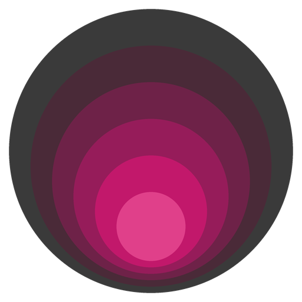
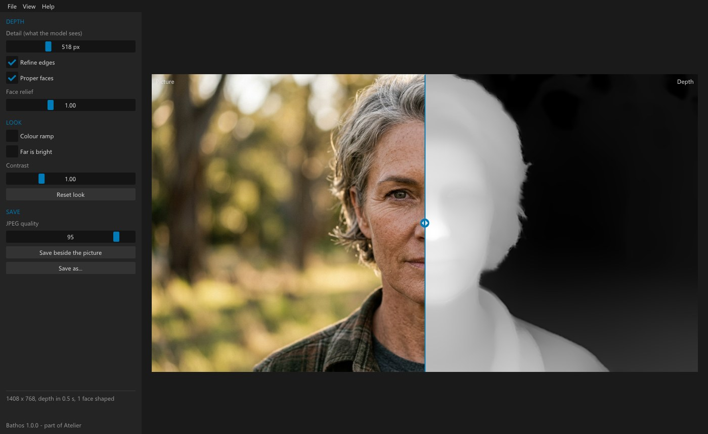
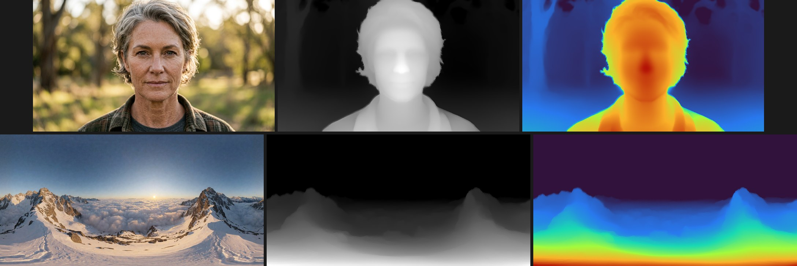

[](https://x.com/NorowaretaGemu)
[](https://opensource.org/licenses/MIT)

<br>
<div align="center">
  <a href="https://ko-fi.com/cursedentertainment">
    
  </a>
</div>
<br>
<div align="center">
  
  
  
  
</div>
<div align="center">
  
  
  
</div>
<br>

<div align="center">
  
</div>

# Bathos

**A picture in, its depth map out.** Bathos works out how far away everything in a photo is, on your own PC, in
C++: near is bright, far is dark. Faces get a real 3D shape, so noses, eye sockets, cheeks and chins have proper
depth instead of a flat blob. Part of **[Atelier](https://github.com/CursedPrograms/Atelier)**, Cursed
Entertainment's creative suite. **[Website](https://cursedprograms.github.io/Bathos/)**





## Features

- **Monocular depth:** Depth Anything V2 (Small) through ONNX Runtime, on the CPU; about half a second for a 2 MP
  photo. No Python, no GPU needed.
- **Proper faces:** every face is found (YuNet), fitted with MediaPipe's 468-point 3D Face Mesh on an upright crop
  (twice, for a tight fit), drawn as a height field and added to the scene's depth, feathered into the hair and neck.
  **Face relief** sets how strongly faces stand out.
- **Refined edges:** a guided filter snaps the depth's edges to the picture's own outlines (hair, branches,
  skylines), so the map doesn't show the blocky steps of the model's 518 px view.
- **The window:** drop a picture; drag the wipe between it and its depth; change the detail, the colour ramp, near or
  far bright, and contrast; save beside the picture or anywhere (JPEG, or lossless PNG).
- **Batches:** drop several pictures at once, or pass them to `bathos-cli`: each gets `<name>_depth.jpg` beside it.
- **A Chimera plugin:** in [Chimera](https://github.com/CursedPrograms/Chimera), Filter > Bathos > Depth Map
  puts the depth of the picture (or a layer) in as a new layer, masked to the selection.

## Minimum requirements

| | |
| --- | --- |
| **System** | Windows 10 or 11, 64-bit (Linux builds from source) |
| **Processor** | any 64-bit processor (the depth runs on the CPU) |
| **Memory** | 4 GB RAM |
| **Graphics** | any graphics card with OpenGL 3.0; no GPU needed for the depth |
| **Disk** | 100 MB |

## Install

Download **Bathos-win64.zip** from [Releases](https://github.com/CursedPrograms/Bathos/releases), unzip it and run
`install.bat` beside it (or just run `Bathos.exe` where it is). The installer puts Bathos in
`%LOCALAPPDATA%\Programs\Bathos` with Start menu and Desktop shortcuts; Chimera finds it there.

The depth model (~99 MB) is downloaded once, on first use, into `%APPDATA%\Atelier\models` (or `F:\AIModels\depth`
when that folder exists). The face models are small and come with Bathos.

## The command line

```
bathos-cli picture.jpg [more pictures...] [options]

  -o FILE         where to write it (one picture only); .png is lossless, anything else is a JPEG
  --size N        the long side the model sees, default 518 (more = finer detail, slower)
  --colour        a colour ramp instead of grey
  --far-bright    flip it: far is bright, near is dark
  --contrast X    above 1 spreads out the near end, below 1 the far end (default 1)
  --no-refine     skip the edge refine
  --no-faces      skip the face shapes
  --face-relief X how strongly faces stand out, 0..3 (default 1)
  --quality N     JPEG quality, default 95
```

Dropping pictures onto `bathos-cli.exe` works too.

## Build

Windows: Visual Studio 2022 (C++) and CMake, then `build.bat` (or `build.ps1`). SDL2 and ONNX Runtime are fetched
into `external/` once; the result is `build/Release/` and `dist/Bathos-win64.zip`, and an installed Bathos is updated.
`install.bat` / `install.ps1` install it.

Linux: `./build.sh` (cmake, a C++17 compiler, libsdl2-dev), then `./install.sh`.

The code, in `src/`:
- `depth.cpp`: the depth core: ONNX Runtime (loaded at run time), Depth Anything V2, the guided-filter edge refine
- `face.cpp`: proper faces: YuNet, MediaPipe Face Mesh, the mesh as a height field, blended into the depth
- `gui.cpp`: the window (SDL2, OpenGL 3, Dear ImGui)
- `cli.cpp`: `bathos-cli`, which Chimera's Filter > Bathos runs

## Credits

Depth: [Depth Anything V2](https://github.com/DepthAnything/Depth-Anything-V2) (Small, Apache-2.0). Faces:
[MediaPipe Face Mesh](https://github.com/google-ai-edge/mediapipe) (Apache-2.0) and
[YuNet](https://github.com/opencv/opencv_zoo) (MIT). Built with [ONNX Runtime](https://github.com/microsoft/onnxruntime),
[SDL2](https://www.libsdl.org), [Dear ImGui](https://github.com/ocornut/imgui) and [stb](https://github.com/nothings/stb).
See [NOTICE](NOTICE).

<br>
<div align="center">
© Cursed Entertainment 2026
</div>
<br>
<div align="center">
<a href="https://cursed-entertainment.itch.io/" target="_blank">
    
</a>
</div>
